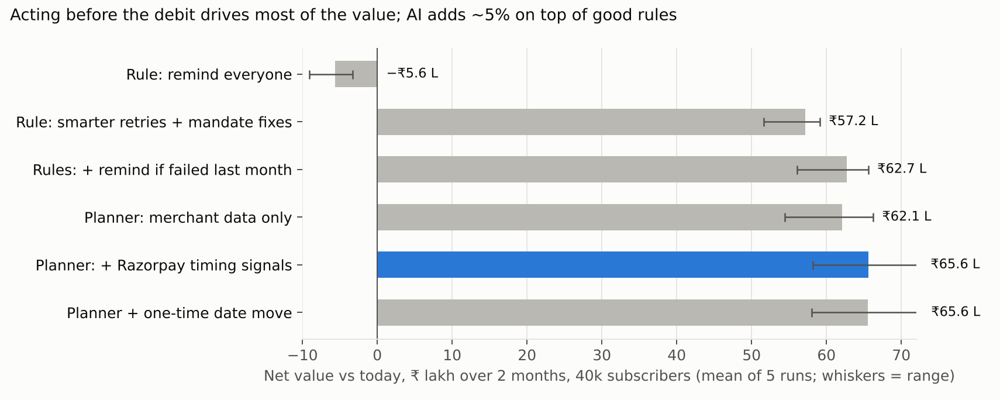
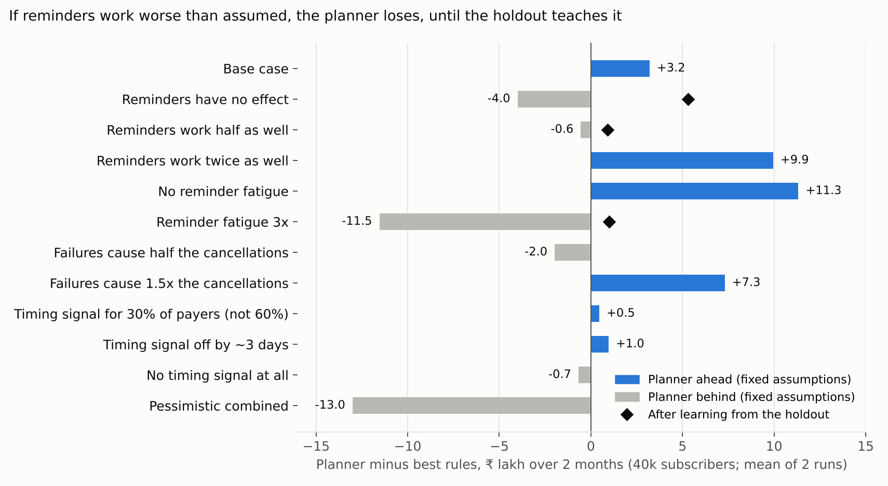

# Debit Risk Planner

**Razorpay AI x PM Build Challenge (ISB) · Track 2: Recover and Grow with AI · Saket**

A concept agent for Razorpay Agent Studio that stops subscription renewals failing *before* the debit. Each night it scores every renewal due in the next 7 days, picks the cheapest fix (a retry timed after payday, a mandate fix, a targeted WhatsApp reminder) and sends the merchant one weekly plan to approve.

> All merchant, customer and result data here is **synthetic**, calibrated to public sources.

| What | File |
|---|---|
| **AI build log** | [`AI_BUILD_LOG.md`](AI_BUILD_LOG.md) |
| Clickable prototype | [Debit Risk Planner] (https://htmlpreview.github.io/?https://github.com/saket-nagampalli/razorpay-debit-risk-planner/blob/main/prototype.html#plan) · or download [`prototype.html`](prototype.html) and open it in a browser |
| One-page product note | [`Product_Note_Debit_Risk_Planner.pdf`](Product_Note_Debit_Risk_Planner.pdf) |
| Model code, results, charts, data sample, research dossier | [`model_code_and_results.zip`](model_code_and_results.zip) |

## Headline (synthetic simulation, 40k subscribers, 2 months)

| Policy | Net value vs today |
|---|---|
| Remind everyone | −₹5.6 L |
| Best fixed rules | ₹62.7 L |
| **Debit Risk Planner** | **₹65.6 L** |

If reminders work worse than assumed, a planner with fixed assumptions loses to good rules; once it learns from a 10% control group it beats them in every scenario tested.

